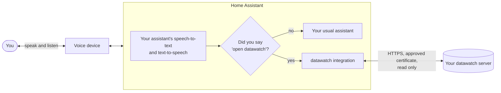

# datawatch for Home Assistant

Ask [datawatch](https://github.com/dmz006/datawatch) how your work is going, by voice,
without touching a screen.

datawatch is a program you run yourself. It starts AI coding assistants, watches them, plans
bigger jobs, and tells you when they need you. This integration lets you check on it from a
Home Assistant voice device.

> **Early release (0.1.0).** It only **reads** from datawatch: nothing you say can change
> anything there. It has been tested with real Home Assistant code and a pretend voice
> device, **not yet with a real microphone and speaker**.

## How it works



Say your wake word and **"open datawatch"**. From then on you are in **datawatch mode**: it
answers, keeps listening, and you give short commands without the wake word. When you
leave, your usual assistant is back, unchanged.

More diagrams and detail: [How it works](docs/how-it-works.md).

## What a conversation sounds like

These counts are made up.

> **You:** "Hey Jarvis, open datawatch." *(use your own wake word)*
> **It:** "Datawatch activated."
> **You:** "Status."
> **It:** "4 open questions, 3 sessions waiting for input and 2 running. Say more detail for more."
> **You:** "List projects."
> **It:** "5 projects. 1, birch. 2, cedar. 3, elm. Say more, or set and a number or name."
> **You:** "Set two."
> **It:** "Focus: project cedar."
> **You:** "Close datawatch."
> **It:** "Closing datawatch."

## What you need

- **Home Assistant 2026.11 or later.** Older versions are not supported.
- **datawatch**, reachable from Home Assistant over HTTPS. Developed against datawatch
  9.187.
- **A voice device that can hold a conversation**, such as Home Assistant Voice PE.
- **An assistant with speech-to-text and text-to-speech** set up for that device. It works
  whether the assistant is Home Assistant's own or an AI model.

## Install

1. In Home Assistant, open the **Marketplace** and add `dmz006/datawatch-hacs` as a custom
   repository of the type *integration*. Home Assistant asks you to connect a GitHub account
   to add custom repositories.
2. Download **datawatch**, then restart Home Assistant when it suits you.
3. Go to **Settings → Devices & services → Add integration → datawatch**.

## Set up

1. Enter your datawatch server's address, starting with `https://`, including the port if it
   needs one. Use an address that **Home Assistant** can reach. Add a token only if your
   datawatch uses one.
2. The next screen shows the server certificate's fingerprint. **Check it** against the
   certificate on the datawatch server. On that server run:

   ```bash
   openssl x509 -in ~/.datawatch/tls/server/cert.pem -noout -fingerprint -sha256
   ```

   That is where datawatch keeps the certificate it makes itself. If you use your own
   certificate, give that file instead.
3. Submit only if the two match. From then on only that certificate is accepted. Nothing,
   including your token, is sent before you approve it.

To change the address or token, or to approve a replaced certificate, choose
**Reconfigure** on the integration. One datawatch server is supported for now.

**Recommended if you use the Whisper app:** give it a hint so it recognises the word
"datawatch". See
[Speech-to-text does not understand "datawatch"](docs/troubleshooting.md#speech-to-text-does-not-understand-datawatch).

## What you can say

To start: your wake word, then **"open datawatch"**, **"use datawatch"** or just
**"datawatch"**.

| In datawatch mode, say | What you hear |
|---|---|
| "status" | Whether new work is paused, open questions, sessions waiting for you and running |
| "more detail" | Failed or blocked automata, items on hold, and failed sessions |
| "list projects", then "more" | Your projects three at a time, in alphabetical order, numbered |
| "set two" or "set project *name*" | Focus on a project. Part of a name works; if several match, you are asked which number |
| "where am I" | The current focus |
| "unset" | Clear the focus |
| "repeat" | The last reply again |
| "help" | The list of commands |
| "close datawatch", "stop", "exit" or "done" | Leave datawatch mode |

**Focus** saves you from naming a project every time. All your voice devices share it, and it
stays until you say "unset", even after you leave. With a focus, session counts are given
for that project and for everything else. datawatch cannot yet filter questions, items on
hold, or failed and blocked automata by project, so you hear those **across all projects**,
and the reply says so.

**You don't have to say "close".** If it hears nothing it asks "Still there?" once, and
after a second silence it closes. It also closes after three phrases in a row that it does
not understand. Saying "close datawatch" ends it straight away.

## Privacy and safety

- **Read only.** The integration only asks datawatch for information.
- **No check of who is speaking.** Anyone who can talk to one of your voice devices can hear
  your datawatch counts and project names. Typed chat cannot start datawatch mode.
- **Your server only.** It connects to the address you enter, and only to a server showing
  the certificate you approved.
- **Speech** is turned into text by the speech-to-text service your assistant already uses.
  In datawatch mode your words are not passed on to an AI model.
- The address, certificate fingerprint and any token are kept in Home Assistant's
  integration settings. The focus (a project name) is kept in Home Assistant's storage.

To report a security problem, see [SECURITY.md](SECURITY.md).

## Good to know

- **Background talk does not keep it open for long.** After three phrases in a row that it
  does not understand, it closes, even if there were silences between them.
- **Fixed phrases.** It does not interpret free speech yet.
- **Your AI assistant knows nothing about datawatch** unless you tell it. See
  [Telling your assistant about datawatch](docs/assistant-context.md).
- **Home Assistant upgrades.** Home Assistant has no public way for an integration to add a
  spoken phrase, so this one uses the same internal function as Home Assistant's own
  sentence automations. An upgrade could change it. If registering the phrase fails, Home
  Assistant shows a repair warning, though not every possible change would be caught that
  way. Tests run against the newest Home Assistant on each change and weekly.

Something not working? See [Troubleshooting](docs/troubleshooting.md).

## Remove

Delete datawatch under **Settings → Devices & services**, which also forgets the focus. Then
uninstall it in the Marketplace and restart. Nothing in your assistant needs undoing.

## Development

See [CONTEXT.md](CONTEXT.md) for how the project fits together and [AGENT.md](AGENT.md) for
the working rules.

```bash
python3 -m venv .venv
.venv/bin/pip install -e ".[test,lint]"
.venv/bin/pip install $(.venv/bin/python tests/requirements_from_ha.py)
.venv/bin/ruff check . && .venv/bin/ruff format --check . && .venv/bin/mypy
.venv/bin/pytest --cov
```

This repository is public. Turn on the hooks once per clone:

```bash
git config core.hooksPath .githooks
```

Before a push, the hooks run the leak checks, lint, type checks and tests, and refuse a
failing or half-committed tree. They need [gitleaks](https://github.com/gitleaks/gitleaks)
and a private list of words that must never be published, at
`~/.config/datawatch-hacs/leak-denylist.txt` (or `LEAK_DENYLIST=/path`): one per line, such
as your own host names, addresses and device names. Keep that file out of the repository.
Use made-up data in code, tests and documentation.

## License

[PolyForm Noncommercial 1.0.0](LICENSE).
