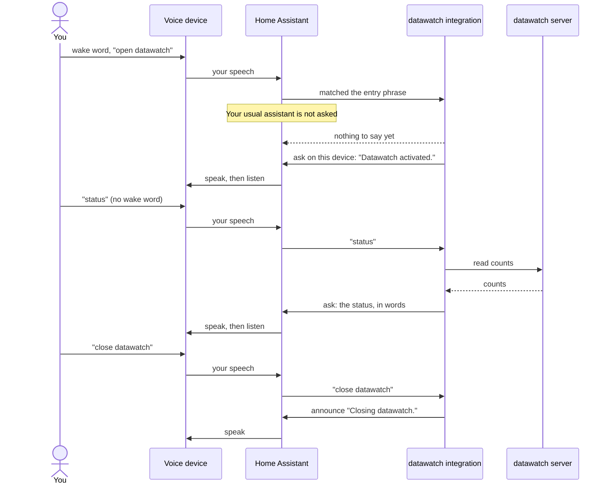
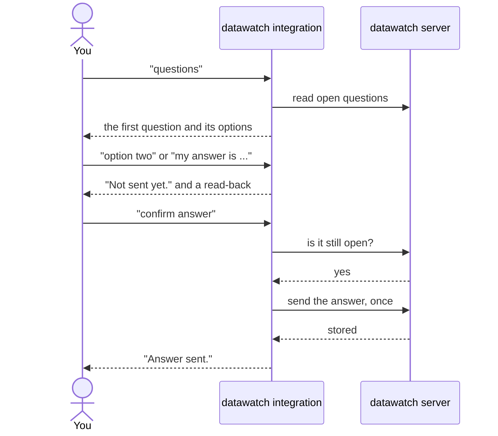
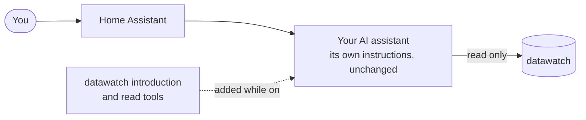
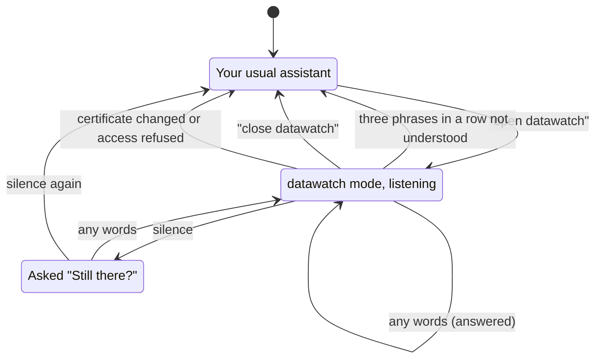
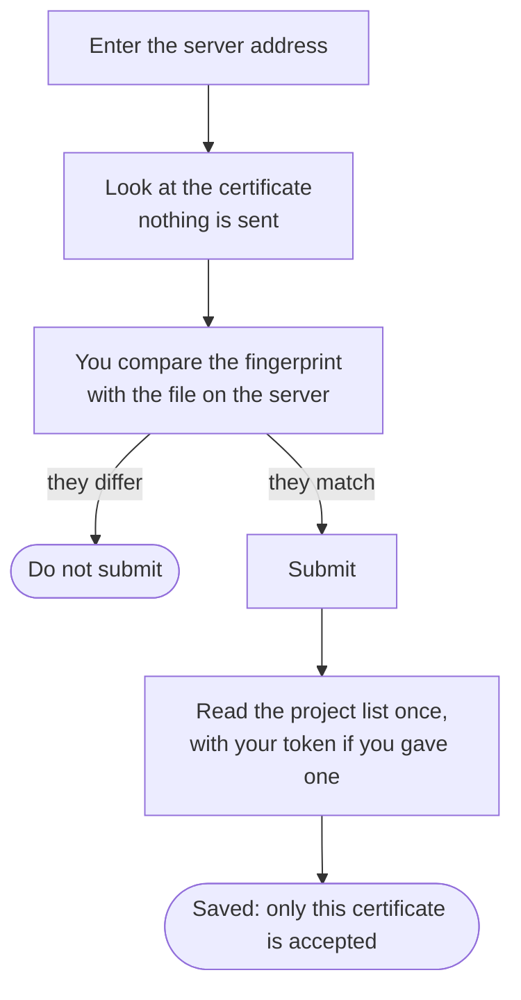

# How it works

## The parts

| Part | What it does |
|---|---|
| Voice device | Hears your wake word, sends your speech to Home Assistant, plays replies |
| Your assistant | Turns speech into text and replies into speech |
| datawatch integration | Notices "open datawatch", holds the conversation, reads datawatch, sends your confirmed answers |
| datawatch server | Holds the information. The only thing sent to change it is an answer |
| AI assistant (optional) | Can read datawatch through the integration's tools |

## One visit

The integration waits for the device to finish your first request before it starts
speaking. Each turn uses Home Assistant's own "ask a question" action, and the goodbye uses
its "announce" action.

## Answering a question

While an answer waits, only "confirm answer" sends it. "cancel" drops it, "repeat" reads it
back, and choosing again or "my answer" changes it. Anything else gets "Not sent yet" and is
**not** passed to an AI assistant. The confirmation has to be the speech Home Assistant
returns for the integration's own question to your voice device. Text from datawatch or
from an AI assistant is never treated as it.

The request holds the option and, if you gave them, your words exactly as speech-to-text
wrote them, marked `comm:voice`. It never asks to replace an earlier answer, so datawatch
refuses it if the question already has one.

## The AI assistant

While an assistant is chosen in datawatch's options, the integration offers Home
Assistant's "device control" tool set five extra tools: `datawatch__status`,
`datawatch__projects`, `datawatch__questions`, `datawatch__search_docs` and
`datawatch__read_doc`. Home Assistant adds the tools and a short introduction to what each
assistant with device control already has. The introduction lists what the tools can do, so
a new feature appears in it when its tool is added. In datawatch mode, other talk is passed
to the chosen assistant with Home Assistant's "process a conversation" action, as one
conversation for the visit.

## What ends a visit

It also closes if the voice device cannot carry on, if something unexpected goes wrong (it
tells you, if the device can still speak), or if Home Assistant unloads the integration.
With an AI assistant chosen, other talk goes to it and does not count as "not understood".
As a safety limit, it gives up on a single reply and answer after 90 seconds, plus longer
for a long reply. It waits up to 120 seconds for the AI assistant. When it first starts, it
waits up to 10 seconds for the device to be ready, then tries anyway.

If datawatch cannot be reached, you hear "I can't reach datawatch. Try again, or say stop."
and you stay in datawatch mode.

## What is read and sent, and when

Entering, leaving, "help", "repeat", "where am I", "unset", "more" and choosing a number
read nothing. "questions" reads the open questions. "status", "more detail" (after status),
"list projects" and setting a project by name read counts or names. Everything is read
fresh each time; nothing is cached and nothing is checked in the background.

| datawatch address | Used for |
|---|---|
| `GET /api/projects` | Project names |
| `GET /api/pause` | Whether new work is paused |
| `GET /api/questions?state=open` | Open questions |
| `GET /api/questions/{id}` | Whether a question is still open, just before answering |
| `POST /api/questions/{id}/answer` | **The only change:** your confirmed answer |
| `GET /api/sessions?view=summary&status=…` | Counts of waiting, running and failed sessions; filtered by project when you have a focus |
| `GET /api/autonomous/held` | Items on hold |
| `GET /api/autonomous/triage` | Failed and blocked automata |
| `GET /api/docs/search`, `GET /api/docs/read` | Documentation, for the AI assistant only |

For the commands, only the focused project's name and your confirmed answer are sent. An AI
assistant's documentation search sends its search words to datawatch.

If datawatch returns something unexpected, you are told it cannot be read. A failed read is
never reported as zero.

## The certificate

datawatch usually uses a certificate it made itself, so there is no outside authority to
vouch for it. Instead you approve it once, and the integration accepts only that one.

If the certificate is later replaced, datawatch mode tells you and closes. Check the new one
and approve it with **Reconfigure**. A saved token is never sent to a different address.
