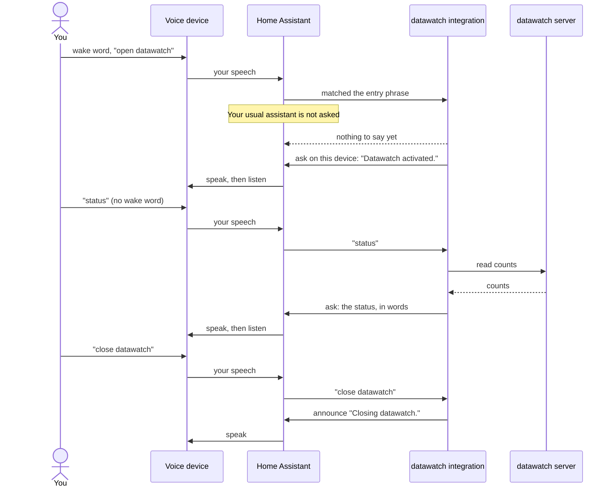
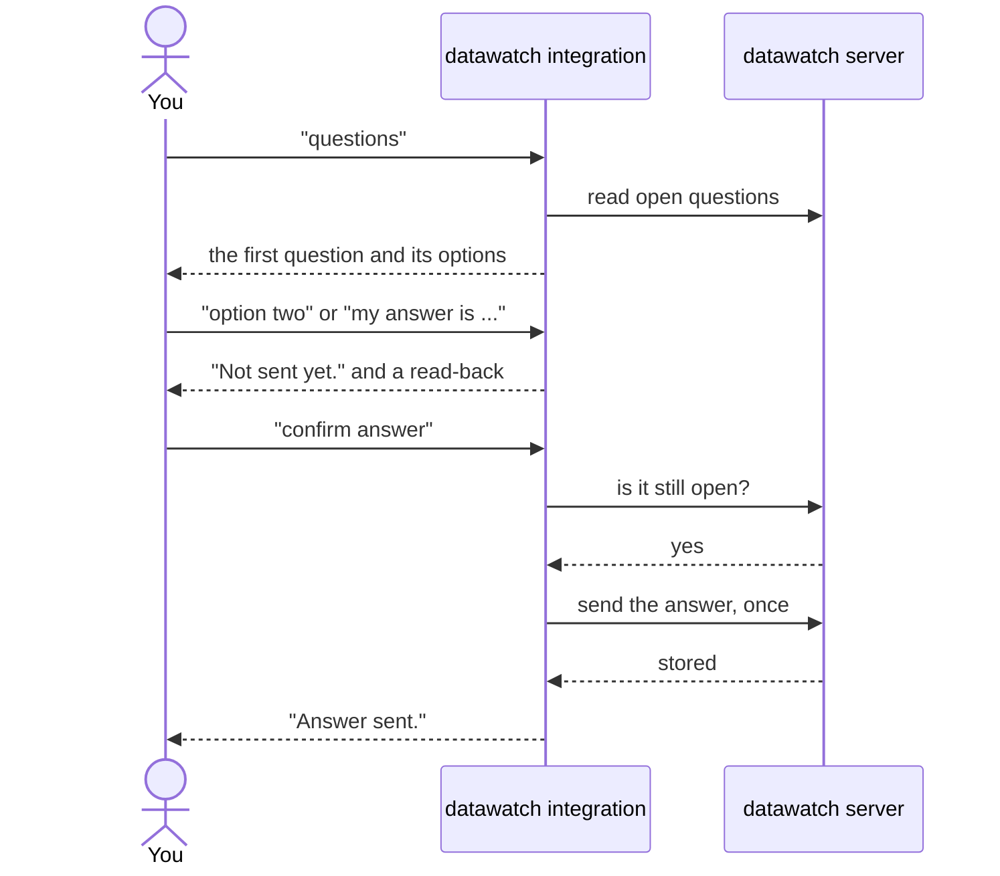
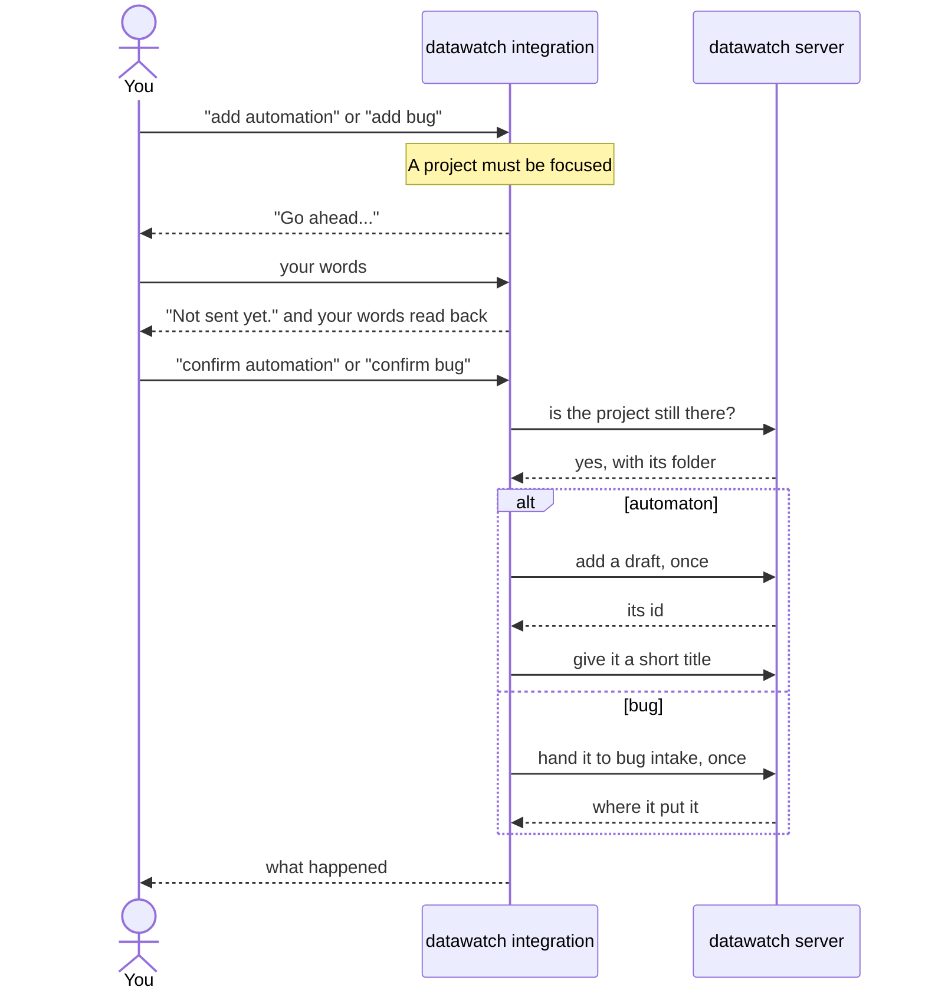
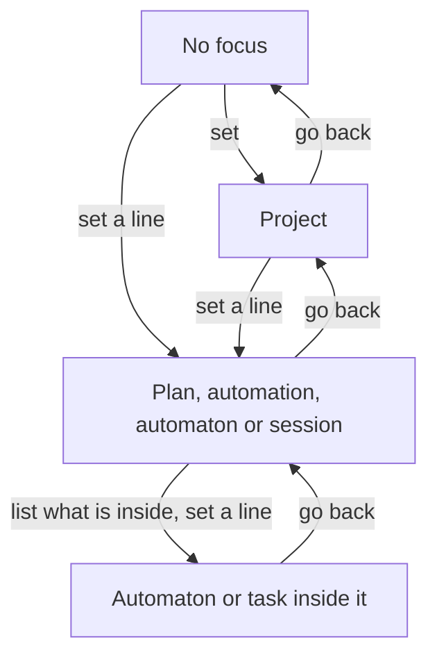
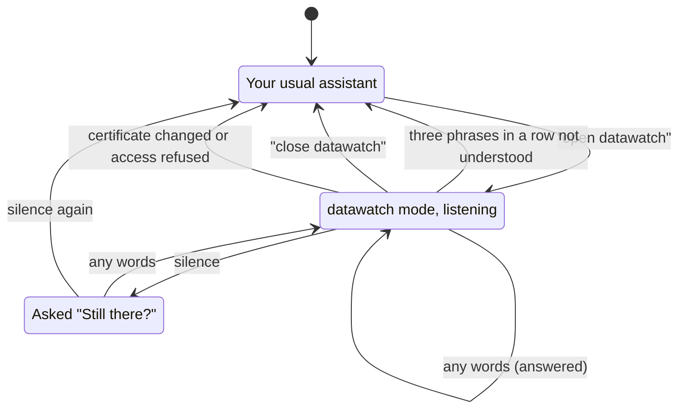

# How it works

## The parts

| Part | What it does |
|---|---|
| Voice device | Hears your wake word, sends your speech to Home Assistant, plays replies |
| Your assistant | Turns speech into text and replies into speech |
| datawatch integration | Notices "open datawatch", holds the conversation, reads datawatch, sends what you confirm |
| datawatch server | Holds the information. It is changed only by what you confirm aloud |
| AI assistant (optional) | Can read datawatch through the integration's tools |

## One visit

The integration waits for the device to finish your first request before it starts
speaking. Each turn uses Home Assistant's own "ask a question" action, and the goodbye uses
its "announce" action.

## Answering a question

While an answer waits, only "confirm answer" sends it. "cancel" drops it, "repeat" reads it
back, and choosing again or "my answer" changes it. Anything else gets "Not sent yet" and is
**not** passed to an AI assistant. The confirmation has to be the speech Home Assistant
returns for the integration's own question to your voice device. Text from datawatch or
from an AI assistant is never treated as it.

The request holds the option and, if you gave them, your words exactly as speech-to-text
wrote them, marked `comm:voice`. It never asks to replace an earlier answer, so datawatch
refuses it if the question already has one.

## Adding an automaton or reporting a bug

Each kind of action has its own confirming words, and the words that confirm an answer send
none of them. Where it goes is fixed when you start: if another voice device changes the
focus while it waits, it still goes to the project you heard in the read-back. While an
action waits, anything but its confirming words, "cancel", "go back", "repeat", saying the
command again or leaving gets "Not sent yet" and is **not** passed to an AI assistant.

A change is sent once and never retried. A lost connection, a fault reported by datawatch or
a reply that makes no sense is reported as "I don't know whether it was sent", never as
success. If a new automaton cannot be given its title, you are told it was added.

Sending to a session follows the same steps ("confirm send"), only to a session you chose
that is waiting for input. It is **switched off** in the code until datawatch has the access
controls for it.

## The AI assistant

While an assistant is chosen in datawatch's options, the integration offers Home
Assistant's "device control" tool set eight extra tools: `datawatch__status`,
`datawatch__projects`, `datawatch__questions`, `datawatch__work`,
`datawatch__automaton`, `datawatch__report`, `datawatch__search_docs` and
`datawatch__read_doc`. Home Assistant adds the tools and a short introduction to what each
assistant with device control already has. The introduction lists what the tools can do, so
a new feature appears in it when its tool is added. In datawatch mode, other talk is passed
to the chosen assistant with Home Assistant's "process a conversation" action, as one
conversation for the visit.

## Focus and "go back"

The focus is a project and then a path, for example a plan, one of its tasks. Commands
about "it" apply to the item you last chose, or else to the end of that path. Plain
"questions" is narrowed only by the focus, so that merely hearing about an item never hides
your other questions.

"Go back" keeps the last 50 steps of a visit. A step is a new list, another question,
choosing a different item or changing the focus. Hearing more of a list, or asking again
about the same item, is not a step. With no step left it removes the last part of the
focus. A waiting answer is never part of a step: going back drops it.

A question belongs to an item only through what datawatch records on the question: its
automaton (for an automaton, or for a plan or automation that holds it), its task, or the
session that asked it.

## What ends a visit

It also closes if the voice device cannot carry on, if something unexpected goes wrong (it
tells you, if the device can still speak), or if Home Assistant unloads the integration.
With an AI assistant chosen, other talk goes to it and does not count as "not understood".
As a safety limit, it gives up on a single reply and answer after 90 seconds, plus longer
for a long reply. It waits up to 120 seconds for the AI assistant. When it first starts, it
waits up to 10 seconds for the device to be ready, then tries anyway.

If datawatch cannot be reached, you hear "I can't reach datawatch. Try again, or say stop."
and you stay in datawatch mode.

## What is read and sent, and when

Entering, leaving, "help", "repeat", "go back", "where am I", "unset" and "more" read
nothing. "go back" repeats what you heard before, so say "status" for a fresh reading. "questions" reads the open questions. "status", "more detail" (after status),
"list projects" and setting a project by name read counts or names. The work reports
("attention", "plans", "overview", "what's next", "automations", "running", "held",
the session lists and "what finished") read their own lists. Choosing an automaton, setting
a focus, and asking about an item read it again each time, so what you hear is current.
Choosing a line that is not an automaton, such as a task or a session, gives what was read
with the list.
Voice replies and AI tools read fresh each time; nothing is cached for them.

The **sensors** are the one thing read in the background. Once a minute the
integration reads the projects, pause state, open questions, session counts, held items,
triage records and the attention list. If any of those reads fails, every sensor shows
unavailable. Turning off polling for the integration stops it. One of your own reports reads
only what its parts need. The optional [dashboard data](../README.md#data-for-your-own-cards-optional)
is read every 5 minutes, one data set at a time; one that fails makes only its own sensors
unavailable.

| datawatch address | Used for |
|---|---|
| `GET /api/projects` | Project names, and a project's folder just before adding an automaton or bug |
| `GET /api/pause` | Whether new work is paused |
| `GET /api/questions?state=open` | Open questions |
| `GET /api/questions/{id}` | Whether a question is still open, just before answering |
| `POST /api/questions/{id}/answer` | **Change:** your confirmed answer |
| `POST /api/autonomous/prds` | **Change:** a confirmed new draft automaton: your words and the project's folder |
| `PATCH /api/autonomous/prds/{id}` | **Change:** that new automaton's short title, right after |
| `POST /api/autonomous/defects/intake` | **Change:** a confirmed bug: a new id, a short title, your words and the project |
| `POST /api/sessions/send` | **Change, switched off:** confirmed words to a session |
| `GET /api/sessions?view=summary&status=…` | Counts of waiting, running and failed sessions; filtered by project when you have a focus |
| `GET /api/dashboard/series/lane-utilization` | Every 5 minutes: lanes and their hourly use |
| `GET /api/dashboard/console`, `lane-pulse`, `series/defects-per-day`, `series/review-backlog`, `series/throughput-forecast` | Every 5 minutes, only while a sensor that shows it is enabled |
| `GET /api/alerts` | Unread alerts. Only titles, levels, times and session links are kept |
| `GET /api/autonomous/held` | Items on hold |
| `GET /api/autonomous/triage` | Failed and blocked automata |
| `GET /api/autonomous/attention` | What needs you. Chosen as datawatch's web app chooses: an attention status, or a task held for review |
| `GET /api/projects/{name}/overview-summary` | Plan counts, progress and what is next. Without a focus, read once per project |
| `GET /api/projects/{name}/plans` | A focused project's plans, up to 500. Also to read one focused plan |
| `GET /api/plans/{id}/automata`, `…/tasks` | What is inside a plan, 50 at most |
| `GET /api/automations/{id}` | One automation: its members and history |
| `GET /api/autonomous/prds/{id}?detail=summary` | An automaton's title and status, for an automation's members (50 at most), a plan's next one, and titles a plan's list leaves empty (20 at most) |
| `GET /api/sessions?view=summary&q={id}` | One focused session |
| `GET /api/sessions?view=summary&automaton=…` or `automation=…` | Sessions inside a focused automaton or automation |
| `GET /api/automations` | Automations; with a focus, datawatch's `project=` filter |
| `GET /api/autonomous/prds?status=running` | Running automata; with a focus, datawatch's `project=` filter |
| `GET /api/autonomous/held` | Also: what is on hold and why |
| `GET /api/autonomous/prds/{id}` | One automaton: its reason and tasks |
| `GET /api/autonomous/prds/{id}/change-record` | What it delivered, if datawatch recorded it |
| `GET /api/autonomous/prds?status=completed` | Completed automata, 50 at most, in datawatch's order (last update). Allowed 30 seconds |
| `GET /api/docs/search`, `GET /api/docs/read` | Documentation, for the AI assistant only |

For the commands, only the focused project's name, the ids of items you ask about and
what you confirm are sent. A search by name is matched inside Home Assistant. An AI
assistant's documentation search sends its search words to datawatch.

datawatch sends an alert's text with the list. The integration does not keep it, say it or
pass it on.

Session lists use the session summaries only. The integration **never requests** a
session's terminal output, last response or prompt.

If datawatch returns something unexpected, you are told it cannot be read. A failed read is
never reported as zero.

## The certificate

datawatch usually uses a certificate it made itself, so there is no outside authority to
vouch for it. Instead you approve it once, and the integration accepts only that one.

If the certificate is later replaced, datawatch mode tells you and closes. Check the new one
and approve it with **Reconfigure**. A saved token is never sent to a different address.
