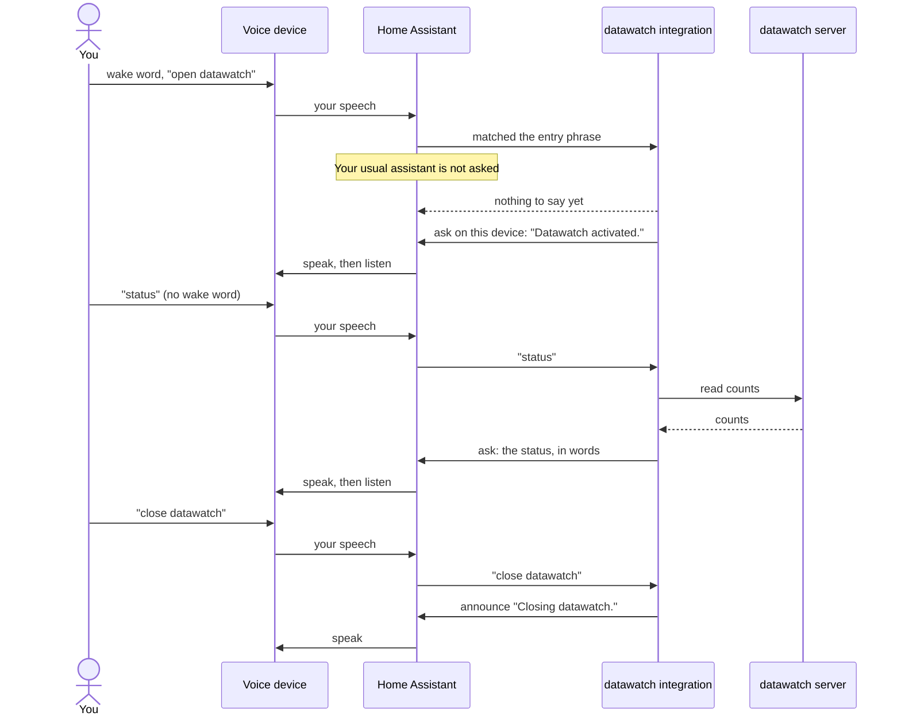
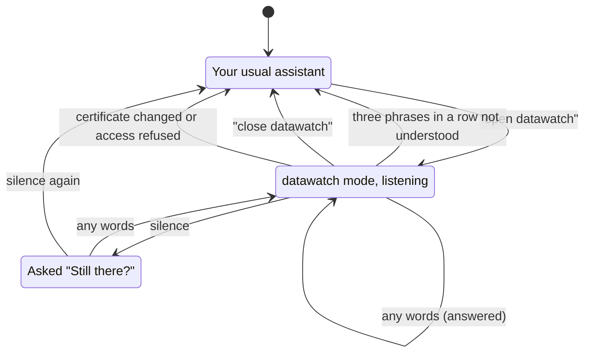

# How it works

## The parts

| Part | What it does |
|---|---|
| Voice device | Hears your wake word, sends your speech to Home Assistant, plays replies |
| Your assistant | Turns speech into text and replies into speech |
| datawatch integration | Notices "open datawatch", holds the conversation, reads datawatch |
| datawatch server | Holds the information. The integration only reads it |

## One visit

The integration waits for the device to finish your first request before it starts
speaking. Each turn uses Home Assistant's own "ask a question" action, and the goodbye uses
its "announce" action.

## What ends a visit

It also closes if the voice device cannot carry on, if something unexpected goes wrong (it
tells you, if the device can still speak), or if Home Assistant unloads the integration.
As a safety limit, it gives up on a single reply and answer after 90 seconds. When it first
starts, it waits up to 10 seconds for the device to be ready, then tries anyway.

If datawatch cannot be reached, you hear "I can't reach datawatch. Try again, or say stop."
and you stay in datawatch mode.

## What is read, and when

Entering, leaving, "help", "repeat", "where am I", "unset", "more", and choosing a number
read nothing. "status", "more detail", "list projects" and setting a project by name read
the following, fresh each time; nothing is cached and nothing is checked in the background.

| datawatch address (all `GET`) | Used for |
|---|---|
| `/api/projects` | Project names |
| `/api/pause` | Whether new work is paused |
| `/api/questions?state=open` | Open questions |
| `/api/sessions?view=summary&status=…` | Counts of waiting, running and failed sessions; filtered by project when you have a focus |
| `/api/autonomous/held` | Items on hold |
| `/api/autonomous/triage` | Failed and blocked automata |

Only the focused project's name is ever sent to datawatch. What you say is not.

If datawatch returns something unexpected, you are told it cannot be read. A failed read is
never reported as zero.

## The certificate

datawatch usually uses a certificate it made itself, so there is no outside authority to
vouch for it. Instead you approve it once, and the integration accepts only that one.

If the certificate is later replaced, datawatch mode tells you and closes. Check the new one
and approve it with **Reconfigure**. A saved token is never sent to a different address.
